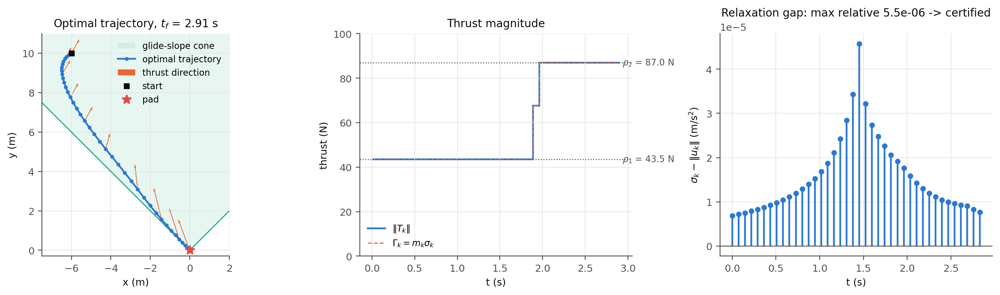
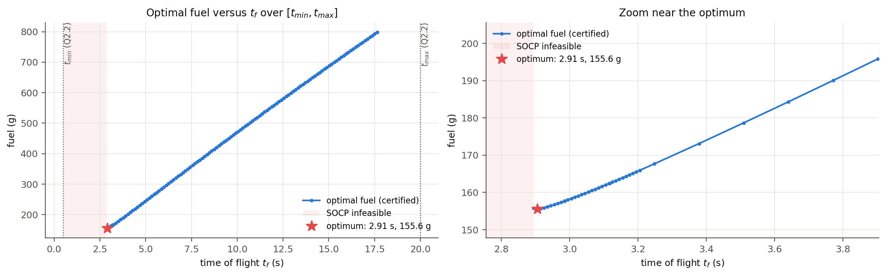
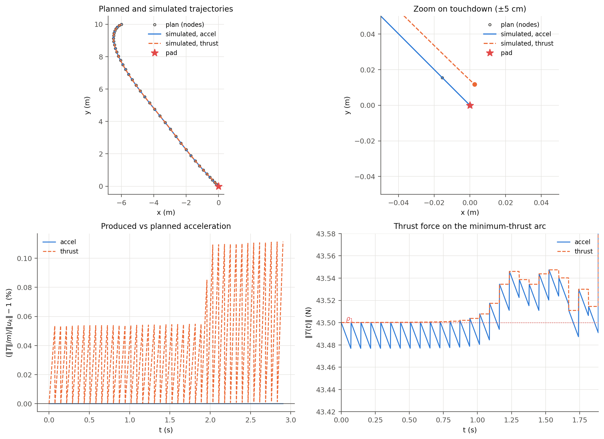
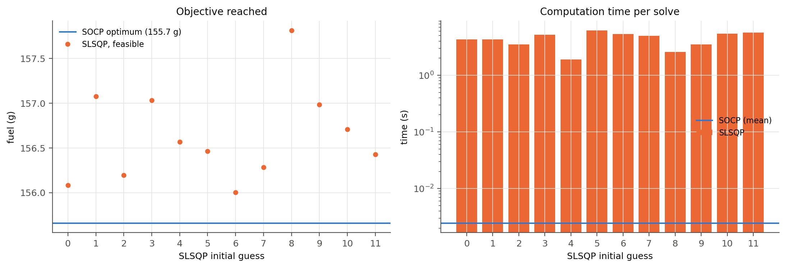
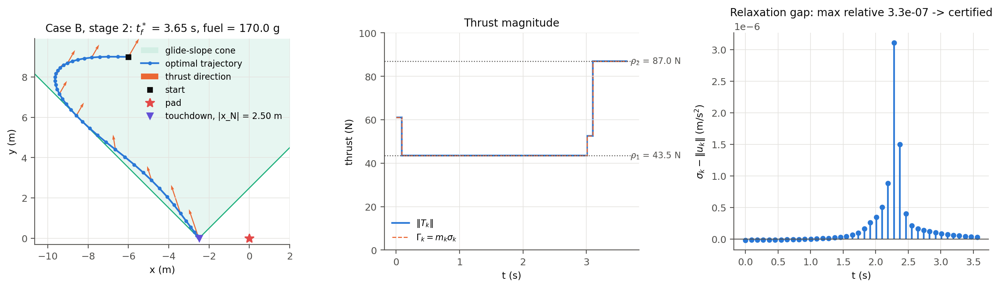
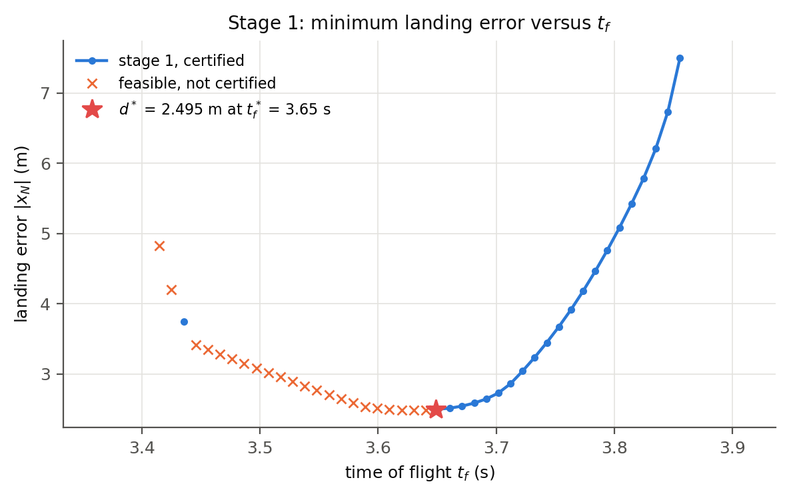

# Carnet de bord — analyses du projet (Phase 1)

Ce dossier contient les scripts qui produisent les figures et les tableaux du rapport, et les résultats obtenus.
Tout se lance **depuis la racine du dépôt**, dans l'environnement conda `convex_opt` :

```bash
conda activate convex_opt
python -m analysis.q31_plots          # Q3.1 : trajectoire, poussée, écart de relaxation, carburant(t_f)
python -m analysis.q31_simulate       # Q3.1 : simulation du plan en modes "accel" et "thrust"
python -m analysis.q31_nonconvex      # Q3.1 : SOCP contre SLSQP sur le problème non convexe (≈ 1 min)
python -m analysis.q32_case_b         # Q3.2 : cas B, guidage en deux étapes (erreur min, puis carburant min)
python -m analysis.q33_benchmark_b1   # Q3.3 : Benchmark B1 (certify=False puis certify=True)
```

Bibliothèques utilisées : uniquement celles citées dans `docs/Questions.pdf` (numpy, scipy, matplotlib, cvxpy) et le
paquet `lander` fourni. Aucune modification du code fourni (`lander/pointmass.py`, `lander/nonconvex.py`, …).

| Fichier | Question | Produit |
|---|---|---|
| `q31_plots.py` | 3.1 (points 1 et 2) | `figures/q31_case_a_solution.{png,pdf}`, `figures/q31_fuel_vs_tf.{png,pdf}` |
| `q31_simulate.py` | 3.1 (point 3) | `figures/q31_simulate.{png,pdf}`, `results/q31_simulate.md` |
| `q31_nonconvex.py` | 3.1 (point 4) | `figures/q31_nonconvex.{png,pdf}`, `results/q31_nonconvex.md` |
| `q32_case_b.py` | 3.2 | `figures/q32_case_b_error_vs_tf.{png,pdf}`, `figures/q32_case_b_solution.{png,pdf}`, `results/q32_case_b.md` |
| `q33_benchmark_b1.py` | 3.3 | `results/q33_b1_certify_false.md`, `results/q33_b1_certify_true.md` |

Cas A (énoncé) : r0 = (−6, 10) m, v0 = (−2, −1) m/s, réservoir plein (m0 = 5.3 kg), N = 40, γ = 45°, θmax = 30°,
g = −10 m/s².

---

## Q3.1 — Solution optimale du cas A (`q31_plots.py`)

**Résultat :** t_f* = **2.905 s**, carburant = **155.6 g** (auto-vérification de l'énoncé : ≈ 2.9 s, ≈ 156 g).



**Certification.** L'écart relatif max_k (σ_k − ‖u_k‖)/σ_k vaut 5.5·10⁻⁶ ≤ 10⁻⁴ : la solution est certifiée
(`is_lossless`). L'écart absolu (≤ 4.6·10⁻⁵ m/s²) est du niveau de la tolérance du solveur ; ‖T_k‖ et
Γ_k = m_k σ_k sont superposés : la relaxation est exacte.

**Structure bang-bang.** La poussée est à une borne presque partout : 26 nœuds à ρ1 = 43.5 N (0 → 1.9 s),
1 nœud de transition (~67 N), 13 nœuds à ρ2 = 87 N jusqu'au contact.
- Le coût ∫Γ et la dynamique sont linéaires en Γ : l'optimum se place à une extrémité de [ρ1, ρ2] (comme un LP
  à un sommet), selon le signe d'une « fonction de commutation » issue du coétat. Structure générale max–min–max ;
  ici le premier arc max a une durée nulle (départ haut et lent).
- **Arc à ρ1** : le moteur ne peut pas s'éteindre, il brûle au plus faible débit. Comme ρ1 = 43.5 N < poids
  (≈ 53 N), c'est une chute contrôlée : la gravité fait gratuitement descendre l'engin. La poussée est inclinée
  vers la droite pour inverser la vitesse initiale vers la gauche ; la trajectoire longe le cône de glide-slope.
- **Arc à ρ2** : freinage maximal le plus tard possible (« suicide burn ») pour annuler la vitesse au contact.
  Freiner tard raccourcit le vol, et chaque seconde en l'air coûte du carburant contre la gravité.
- Le nœud à ~67 N est un effet de discrétisation : l'instant de commutation tombe dans un intervalle et le
  bloqueur d'ordre zéro moyenne la poussée sur cet intervalle (valeur dans [ρ1, ρ2], donc admissible).

## Q3.1 — Carburant optimal en fonction de t_f (`q31_plots.py`)



- SOCP infaisable pour t_f < ≈ **2.895 s** (la borne de Q2.2 donne seulement t_f ≥ 0.5 s) ; au-delà, toutes les
  solutions sont certifiées jusqu'à 17.6 s. Le carburant croît presque linéairement, ≈ **43.6 g/s**.
- L'optimum (2.905 s) est collé à la frontière de faisabilité (écart = tolérance 0.02 s de la section dorée).

**Pourquoi t_f optimal ≈ t_f minimal.** Chaque seconde de vol coûte du carburant juste pour lutter contre la
gravité (*gravity losses*) : au moins αρ1 = 40 g/s (le moteur ne descend jamais sous ρ1), et tenir le poids
coûterait α m |g| ≈ 48.7 g/s ; la pente mesurée (43.6 g/s) est entre les deux. La partie « utile » (annuler la
vitesse, rejoindre le pad) coûte à peu près pareil quel que soit t_f. Il faut donc atterrir le plus vite
possible ; la limite est fixée par la poussée max ρ2 (avec les contraintes d'inclinaison et de glide-slope). La
borne t_min = 0.5 s de Q2.2 est très lâche : elle n'utilise que ‖v0‖ et ignore gravité, distance et contraintes.

## Q3.1 — Simulation du plan, modes "accel" et "thrust" (`q31_simulate.py`)

| mode | erreur de position finale | erreur de vitesse finale | carburant | violation de poussée |
|---|---|---|---|---|
| `accel` | 1.1·10⁻⁸ m | 2.0·10⁻⁹ m/s | 155.56 g | 2.3·10⁻² N (sous ρ1) |
| `thrust` | 1.2·10⁻² m (1.2 cm) | 1.3·10⁻² m/s | 155.62 g | 0 |



**Raison physique.** Le plan est exact pour une *accélération* u_k constante sur chaque intervalle.
- `accel` : le moteur produit T(t) = m(t) u_k, donc T/m = u_k exactement → le simulateur reproduit le plan
  (erreurs ~10⁻⁸, précision de l'intégrateur RK4).
- `thrust` : la *force* T_k = m_k u_k est figée au début de l'intervalle, mais la masse diminue
  (ṁ = −α‖T‖) : l'accélération T_k/m(t) devient un peu plus grande que prévu (dent de scie : +0.05 % sur l'arc
  à ρ1, +0.11 % sur l'arc à ρ2, figure en bas à gauche). L'engin freine un peu trop : il s'arrête ≈ 1.2 cm
  au-dessus du sol avec une petite vitesse résiduelle. L'erreur se réduit avec N (intervalles plus courts).
- Contrepartie : en mode `accel`, la force décroît dans l'intervalle et passe légèrement **sous ρ1** sur l'arc
  à poussée minimale (≈ 0.02 N, figure en bas à droite) ; en mode `thrust`, la force reste dans [ρ1, ρ2].

## Q3.1 — SOCP contre la référence non convexe SLSQP (`q31_nonconvex.py`)

Cas A, **N = 20**, **t_f = 2.909 s** (optimum de `solve_min_fuel` avec N = 20, utilisé par les deux méthodes).
SLSQP (`lander/nonconvex.py`, fourni) résout (P) sans relaxation, depuis 12 initialisations aléatoires.
Tableau complet, run par run : `results/q31_nonconvex.md`.

| | SOCP (LCvx, Clarabel) | SLSQP sur (P), 12 départs |
|---|---|---|
| succès annoncé par le solveur | 12/12 | 11/12 |
| solution admissible (contraintes de (P) à 10⁻⁴) | 12/12 | 12/12 |
| atteint l'optimum du SOCP (±0.1 %) | 12/12 | **0/12** |
| carburant meilleur / médian / pire (g) | 155.66 / 155.66 / 155.66 | 156.00 / 156.52 / 157.81 |
| temps par résolution, moyen / max | **0.002 s** / 0.002 s | **4.3 s** / 6.1 s |



- **Objectif.** Les 12 runs SLSQP finissent tous au-dessus de l'optimum du SOCP (+0.22 % à +1.38 %), chacun à
  une valeur différente : ce sont des minima locaux / points stationnaires, qui dépendent de l'initialisation.
  Le SOCP est convexe : pas d'initialisation, le solveur renvoie l'optimum global, toujours le même ; grâce à la
  relaxation sans perte (certifiée) il est aussi l'optimum global du problème discret non convexe (P).
- **Comparaison équitable.** SLSQP mesure le carburant avec son propre modèle discret (force constante sur
  l'intervalle, masse du début d'intervalle). Le plan SOCP rejoué dans ce modèle consomme 155.79 g (+0.08 %) et
  arrive à 0.2 mm du pad : cet écart de modèle est bien plus petit que l'écart de SLSQP, la conclusion tient.
- **Fiabilité.** SLSQP annonce un échec sur 1 run (le n° 5) alors que sa solution est
  admissible ; et « convergé » ne veut pas dire « optimal ». Le SOCP a un certificat (dualité + écart de
  relaxation nul) : on sait qu'on est à l'optimum.
- **Temps.** ≈ 2 000 fois plus rapide (2 ms contre 4 s). SLSQP calcule des gradients par différences finies
  sur une simulation non linéaire ; le SOCP est compilé une seule fois (DPP), ensuite seule la valeur des
  paramètres change. C'est ce qui permet de refaire le plan en boucle fermée toutes les 0.5 s (Q4).

## Q3.2 — Cas B, guidage en deux étapes (`q32_case_b.py`)

Cas B : r0 = (−6, 9) m, v0 = (−6, 0) m/s, **0.17 kg** de carburant (m0 = 4.67 kg), N = 40.
Code : `mode="error"` (étape 1, min |x_N|), `mode="fuel_with_error_bound"` (étape 2, min carburant avec
|x_N| ≤ dmax) et `solve_min_landing_error` dans `lander/lcvx.py` ; la recherche sur t_f est la même fonction que
pour `solve_min_fuel` (`_tgo_search`, grille puis section dorée, solutions non certifiées = infaisables).

**Pad inatteignable.** `solve_min_fuel` : 0 t_f faisable sur 25 points de [t_min, t_max] = [0.50, 4.25] s.

| | résultat (certify=True) |
|---|---|
| erreur d'atterrissage minimale d* | **2.495 m** (posé en x_N = −2.496 m) |
| temps de vol t_f* | **3.649 s** |
| carburant consommé (étape 2) | **169.99 g** sur 170 g (il reste 0.007 g) |
| solution de l'étape 2 certifiée | oui (écart relatif max 3.3·10⁻⁷) |




- **Pourquoi c'est inatteignable.** L'engin part à 6 m/s *en s'éloignant* du pad. Le moteur ne s'éteint jamais
  (≥ αρ1 = 40 g/s), donc 170 g donnent au plus t_max = 4.25 s de vol. En si peu de temps, il faut à la fois
  annuler 6 m/s vers la gauche (il recule jusqu'à x ≈ −9.6 m), revenir vers la droite et freiner la descente :
  il manque ≈ 2.5 m.
- **Structure de la poussée.** max – min – max (un nœud à ≈ 61 N au départ, long arc à ρ1, freinage
  final à ρ2) et **tout le carburant est utilisé** : avec la cible hors de
  portée, chaque gramme sert à se rapprocher. Le glide-slope est ancré au point de contact x_N.
- **Étape 1, d en fonction de t_f.** Faisable seulement sur une fenêtre étroite (≈ 3.41–3.86 s) : en
  dehors, plus de solution faisable (trop court : la poussée max ne suffit pas pour se poser en douceur ;
  trop long : sans doute le carburant, qui ne permet pas de rester en l'air plus longtemps — non vérifié). Les solutions les plus
  précises pour t_f < 3.65 s **ne sont pas certifiées** (croix orange) : sans certification on trouverait
  d* = 2.484 m (1 cm de mieux) mais avec un plan non réalisable. Le point certifié isolé vers 3.43 s est un cas
  limite (une seule solution certifiée dans cette zone) ; il ne change pas l'optimum.
- **Étape 2** : à t_f*, minimum de carburant avec |x_N| ≤ d* + 1 mm. Ici l'étape 1 utilisait déjà tout le
  carburant, donc l'étape 2 consomme pareil ; son rôle est de choisir, parmi les trajectoires d'erreur d*,
  celle qui est économe et certifiée (relaxation exacte).
- **Simulation du plan** (`results/q32_case_b.md`) : mode `accel` exact (10⁻¹²) ; mode `thrust` 2.6 cm
  d'écart et **170.08 g** consommés, soit plus que le réservoir : avec zéro marge de carburant, l'effet
  « force constante, masse qui baisse » de Q3.1 devient critique (le simulateur ponctuel ne coupe pas le moteur
  quand le réservoir est vide).

## Q3.3 — Benchmark B1 (`q33_benchmark_b1.py`)

Tableaux complets : `results/q33_b1_certify_false.md` et `results/q33_b1_certify_true.md`.
Les cas 17–19 (cible inatteignable) utilisent le guidage en deux étapes de Q3.2 ; un atterrissage compte
comme réussi à d* + 5 cm près.

| | certify=False | certify=True |
|---|---|---|
| atterrissages, cas 0–16 (atteignables) | 17/17 | 17/17 |
| atterrissages à d* + 5 cm, cas 17–19 | 3/3 | 3/3 |
| cas avec écart de relaxation (> 10⁻³ m/s²) | 17/20 | 0/20 |
| écart de relaxation max | 1.21 m/s² | 7.8·10⁻⁴ m/s² |
| violation de poussée max (simulation) | **5.84 N** (sous ρ1) | 0.035 N |
| violation de glide-slope max (entre les nœuds) | 2.7 mm | 2.1 mm |
| carburant moyen (20 cas) | 139.9 g (mais solutions irréalisables) | 145.3 g |
| temps de calcul moyen / max | 0.15 / 0.24 s | 0.15 / 0.25 s |

Les petites violations de glide-slope (≈ 2 mm, cas 17–19) viennent du fait que le cône n'est imposé qu'aux
nœuds t_k : entre deux nœuds la trajectoire peut passer légèrement sous le cône (cf. Q2.1).

**Premières observations (pour la personne qui rédige Q3.3).** Avec `certify=False`, la recherche sur t_f
pousse t_f vers son minimum et l'écart apparaît sur l'arc à poussée minimale. Vérifié sur les cas 5 et 8 :
aux nœuds avec écart, la contrainte d'inclinaison est active (u_y = cos θmax σ), Γ = ρ1, et ‖T_k‖ tombe à
≈ 37.7 N < ρ1 = 43.5 N : exactement le cas « corde du segment circulaire » décrit dans l'introduction de la
Phase 1 (λ_v vertical → ‖T‖ < Γ). Le simulateur vole alors une poussée que le moteur ne peut pas produire
(violation jusqu'à 5.8 N). Avec `certify=True`, ces t_f sont rejetés : t_f optimal plus long (cas 5 :
2.98 → 3.50 s ; cas 8 : 2.38 → 2.67 s) et un peu plus de carburant (cas 5 : 142 → 159 g), mais le plan est
réalisable. Reste à faire pour Q3.3 : montrer en simulation ce qui se passe quand on vole une solution non
certifiée (par ex. avec la poussée bornée à ρ1).

## Q5 — Outil de debug d'un épisode (`q5_debug.py`)

Une figure par (politique, scénario, seed) : carte avec les dangers gonflés par la boîte R_X × R_Y, tous les
plans recalculés (clair = tôt, foncé = tard), le vol réel coloré selon l'issue et la boîte au moment de la
clearance minimale ; à droite, position contre plan actif, erreur de suivi (+ phase), clearance signée aux
dangers et au terrain (+ min de chaque plan), vent vrai / connu / estimé, θ et commandes moteur.

```bash
python -m analysis.q5_debug --policy lander.controllers:make_cascade --scenarios S04 --seeds 3
python -m analysis.q5_debug --policy submissions/Q5/gcs.py --scenarios all --seeds 0-9 --failures-only
python -m analysis.q5_debug --policy ... --scenarios S05 --seeds 1 --show      # fenêtre interactive
```

Figures dans `analysis/figures/debug/` (ignoré par git). Sans rien changer, l'outil lit l'attribut `plan` du
contrôleur (comme `CascadeController`). Pour le contrôleur Q5, on peut exposer en plus :
- `self.debug_plans` : liste de dicts `{"t", "p" (N+1, 2), "dt", "margin" (optionnel)}`, un par plan ;
- `self.debug_regions` : liste de polygones convexes (repère pad), par ex. les régions du GCS.
